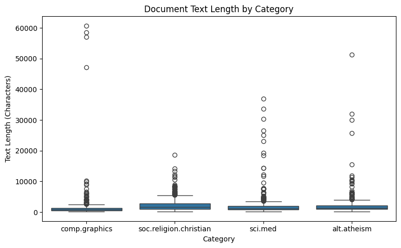
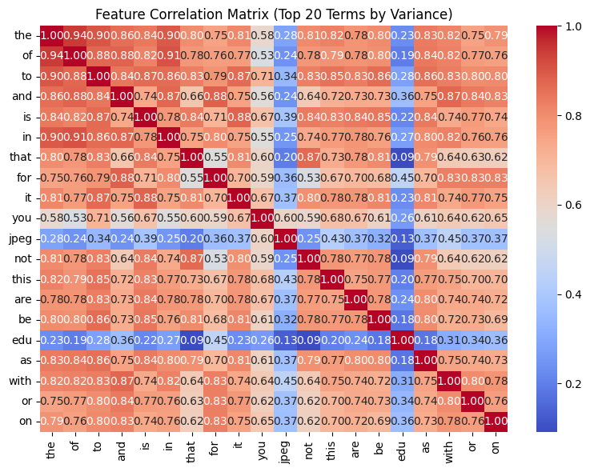
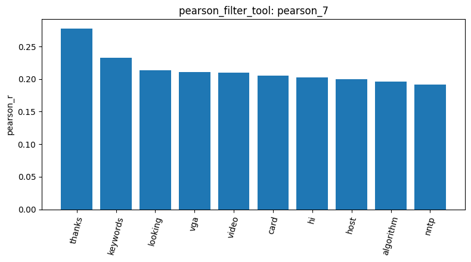

use inspect_data_tool it will help you to inspect a few rows to help identify the structure of the dataset.
The check_missing_tool was used to identify documents with missing text, we didnt have any missing text.
The check_duplicates_tool was used to identify duplicate documents, we didint find any duplicate documents.
The describe_data_tool was used to examine basic document-length statistics and visualize document lengths by category
The sample_data_tool was used to select a smaller subset of the dataset for more efficient analysis, I had a problem in here because the sample was created but once i wanted to apply other tools on it, it didnt refer it , i tried to change what it was telling me it was wrong but couldn´t have the good answer. I continued using the whole data but it was taking too much time and consuming my keys and that it requires too many tokes. So using this tool is effeective so we dont reduce the time consuming. Using the unpaid API keys it was not possible to do question no.14.
The build_dtm_tool was used to represent the text documents as a document-term matrix, but when running it, it selected the whole data not the sample one, but we found we have 35788 terms , non zero elements=365886, total matrix elements = 80773516 and sparsity: 99.5% from the whole data. 
The term frequency helped me to know how frequently terms occur across the documents, in this case I didnt do the stop words so it was counting the common words like to, and, the, etc.
The dtm_heatmap_tool was used to visualize the data (was suppossed to be the sample) of the document-term matrix, as I said before , it took the common words such as and, the , in, is that.etc. 
The variance_filter_tool was used to identify and remove terms with low variance. I set a threshold of 0.02.
The pearson_filter_tool were used to evaluate associations between terms of the com.graphics category 
The feature_correlation_matrix_tool was used to examine correlations among the surviving features, in this case it took again the most common words used in documents and not the reduce ones.
I couldnt fix the probelm of sampling and it was taking so long to analize the whole data and consuming my tokens and API keys so i was unable to continue.

