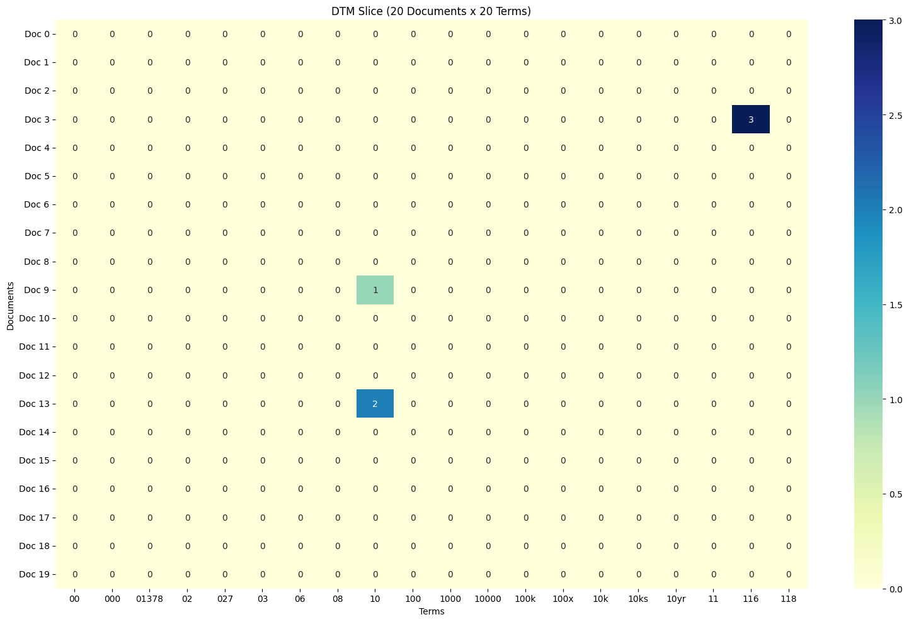
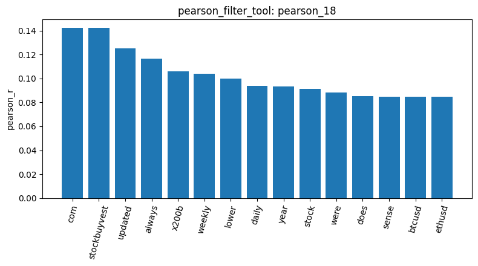
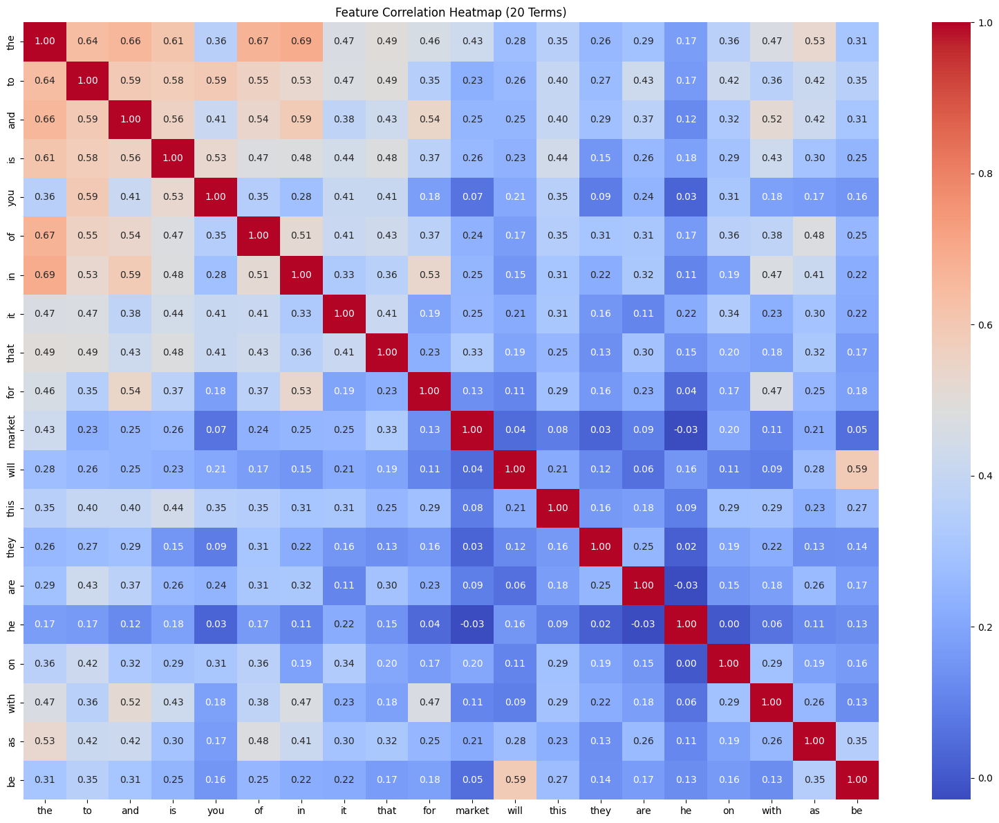

2. Inspect the Data

 The dataset contains 847 documents with three columns: text, category_name, and category. This step helps understand the data before processing.

3. Check Missing Text
No missing text was found among the 847 documents.

4. Check Duplicate Documents
The check_duplicates_tool identified 23 duplicate documents among the 847 rows. However, duplicates were not removed, so all 847 rows remained.

5. Describe Document Length
The mean document length was 148.68, the median was 79, and the maximum was 2,753. 

6. Subsample the Data
7. Build the Document-Term Matrix
The resulting matrix contained 847 documents and 4,346 terms, with 17,193 non-zero entries and 99.53% sparsity. This representation allows text to be analyzed numerically. 

8. Analyze Term Frequency
The most common were the (920 occurrences), to (566), and (488), is (402), and it (350). This analysis reveals common vocabulary, but the results also show that English stop words remain in the current representation.
Here again some issues by trying to stop english common words, couldnt fix it.

9. Visualize the Document-Term Matrix 
10. Filter Terms by Variance
11. Filter Terms by Pearson Correlation 
The pearson_filter_tool measured the correlation between terms and category 0.0. The top results included com and stockbuyvest (Pearson r = 0.1422), followed by updated (0.1250) and always (0.1165).

12. Analyze Feature Correlations 

13. Visualize Results
14. the program crashed, i tried to mmine frequent patterns from -1.0 and 1.0 but no results. i image because the data is so big that it takes so long.

